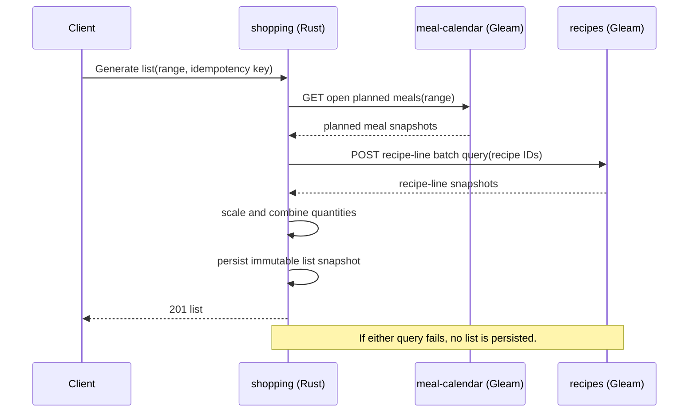

# Design — Modular, Multi-Process Meal Prep

## Decision

Build the Meal Prep modules as independently runnable processes with language-
neutral HTTP/JSON contracts and separate data stores. Use languages deliberately:

| Deployable | Language | Owns |
|---|---|---|
| `ingredients` | Gleam | reusable ingredient catalogue |
| `recipes` | Gleam | recipes and recipe-line snapshots |
| `meal-calendar` | Gleam | planned and eaten meal records, recency |
| `recipe-finder` | Go | read-only recipe search, filtering, ranking and fallback |
| `shopping` | Rust | generated shopping-list snapshots and their edits |

`quantity` is **not** a network service and not a source library shared across
languages. It becomes a language-neutral policy: a versioned specification and
shared JSON conformance fixtures. Gleam and Rust each implement the policy
locally and must pass the same examples. This avoids a remote call for basic
arithmetic while preventing silent divergence.

For the first iteration, each state-owning process uses its own SQLite database
(or database file) and is the only process that reads or writes it. The
read-only `recipe-finder` owns no database.

No event broker is introduced initially. Cross-process operations use bounded,
synchronous HTTP calls. Each owning service supplies a small query API; the
consumer defines an adapter in its own language. Later, an outbox/event stream
may be added only if polling/query composition becomes inadequate.

## Boundary and call model

A service may call another service only through its published contract. It does
not import the other service's domain types, access its database, or require the
other service to use the same language.

## Contracts

- Version every public endpoint under `/v1/`.
- JSON field names and enum values are the published language. IDs are opaque
  strings; consumers must not infer meaning from them.
- Query responses return only the snapshot a consumer needs. For example,
  `recipes` supplies recipe id, name, basis, and line snapshots; it does not
  expose its tables.
- Commands accept a client-generated idempotency key. The owning service stores
  the key and prior response long enough to make a repeated request return the
  same result rather than create another record.
- Additive fields and enum values are backward-compatible only when old clients
  can ignore them. A breaking change requires a `/v2/` endpoint and a migration
  period with both versions live.
- Quantity policy fixtures are versioned alongside the contract. A change to
  unit semantics requires passing the fixtures in every implementation before
  it can be released.

## Consistency and failure rules

- A command changes data only in its owning service. There are no distributed
  transactions.
- A composed command such as shopping-list generation first reads calendar and
  recipe snapshots, then writes one local shopping-list snapshot. If either
  dependency is unavailable, it returns `503` and writes nothing.
- Reads use a 2-second per-call timeout. The caller may retry an idempotent GET
  once for a connection-level failure; it must not retry a timed-out command
  automatically without the same idempotency key.
- If a command's response is lost after persistence, retrying with its original
  idempotency key returns the original result.
- A shopping list is intentionally a snapshot. Later recipe edits, meal moves,
  or downstream outages never rewrite it.
- `recipe-finder` degrades by showing a clear unavailable state when either its
  recipe or recency query fails; it must not present partial ranking as complete.

## Trust and operational boundary

Initially all processes run as one household application on a trusted local
network or developer machine. They are separate failure and data-ownership
boundaries, not separate user-security domains.

- A single edge gateway is the future authentication point. It validates the
  caller and forwards a household identity to internal services.
- Each service authorizes that identity against only its own records; it does
  not trust a client-supplied household or owner id.
- Until authentication exists, bind service ports to loopback or a private
  container network. Do not expose databases or internal service ports publicly.
- Log request id, service, endpoint, status, latency, and dependency failure.
  Do not log recipe contents, shopping-list text, or user/household identifiers
  beyond a redacted correlation value.

## Data migration and rollback

Each service owns its own schema migration history. Use expand-and-contract:

1. Add a nullable/additive field or new endpoint while readers accept both
   shapes.
2. Deploy consumers that can read the old and new shape.
3. Backfill or switch writers.
4. Remove the old shape only after all consumers have migrated.

A rollback is safe only while the previous service version can read data written
by the new version. Destructive schema changes and endpoint removals therefore
require a later release.

## Alternatives considered

### One Gleam modular monolith

**Benefits:** simplest debugging, one transaction boundary, and a genuine
single shared `quantity` library.

**Rejected because:** it defeats the explicit learning goal of writing Rust and
Go, and language boundaries would be discovered later by a disruptive split of
already-coupled code.

### Shared database with services in different languages

**Benefits:** less query API work and easy reporting.

**Rejected because:** it makes database tables the undocumented contract. Any
service can bypass another's invariants or couple to its migrations, so a module
is not actually independently changeable.

### Event broker from the first release

**Benefits:** looser runtime coupling and a path to derived read models.

**Rejected because:** delivery, deduplication, ordering, replay, and outbox
handling would dominate a small fun project before it has a useful workflow.
Synchronous queries make the first failure modes visible without adding broker
operations.

### One remote quantity service

**Benefits:** exactly one implementation of unit conversion.

**Rejected because:** every recipe and shopping operation gains an availability
and latency dependency for pure arithmetic. Versioned fixtures give comparable
semantic protection while keeping the rule local and testable.

## Required plan amendments

The existing `modules.md` and M001–M016 assume packages in one application, so
they are not executable as written under this decision. Before implementation:

1. Replace local ports in each relevant work item with the required `/v1/` query
   or command contract, timeout, and unavailable behavior.
2. Split M001 into a quantity-policy specification/fixture task and per-language
   Gleam/Rust conformance implementation tasks.
3. Add service bootstrap, health endpoint, SQLite ownership, contract tests, and
   local orchestration tasks for each state-owning service.
4. Add a Go `recipe-finder` service task and Rust `shopping` service task; both
   must use consumer-owned HTTP adapters rather than direct database access.
5. Add an edge/gateway task before any service is exposed beyond the private
   development network.

## Acceptance criteria for dependent work

- Each process can start, migrate, and serve a health endpoint without another
  process accessing its database.
- A consumer communicates with another module only through a versioned HTTP/JSON
  contract covered by provider and consumer contract tests.
- Repeating a command with the same idempotency key creates no extra record and
  returns the original result.
- A failed or timed-out dependency query during shopping-list generation returns
  `503` and leaves no persisted shopping list.
- Gleam and Rust quantity implementations both pass the same versioned
  conformance fixtures, including mixed mass/volume cases.
- No service port or database is publicly exposed before the gateway and
  authentication boundary are implemented.
